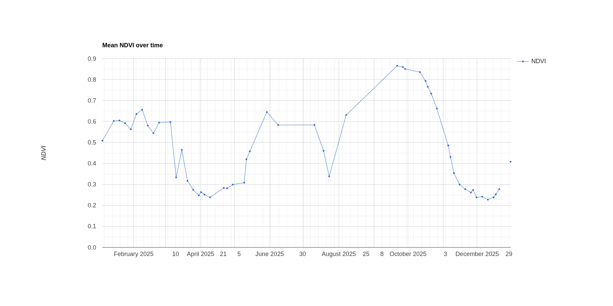
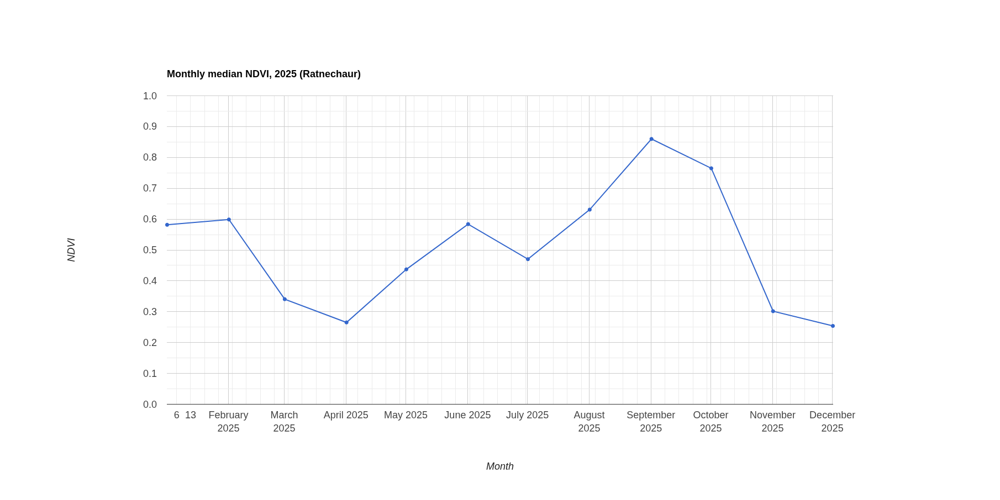
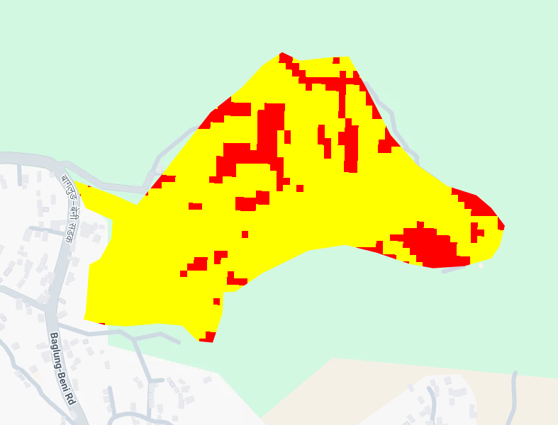
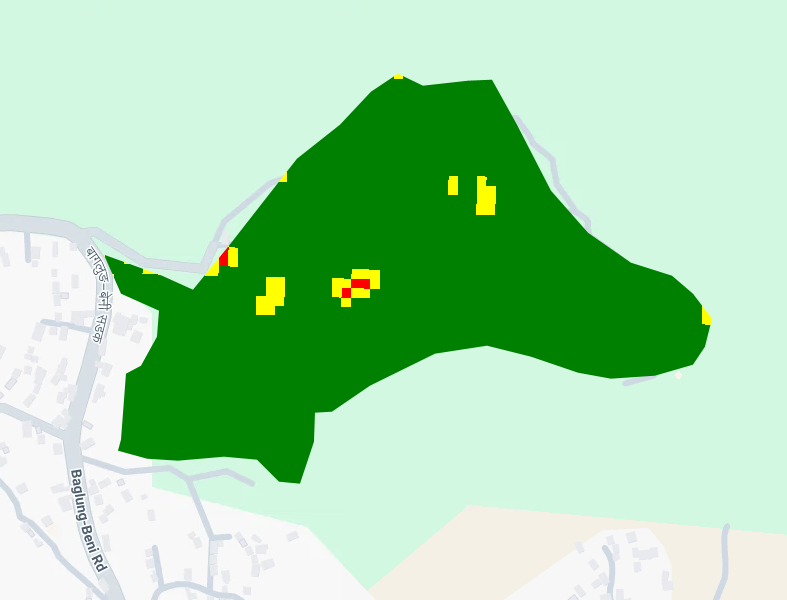
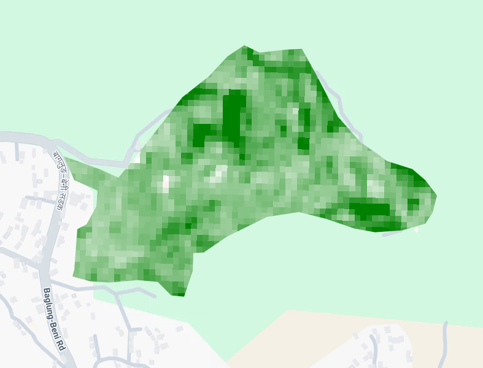
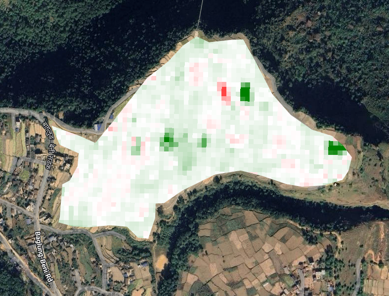

# Crop Monitoring with Sentinel-2 NDVI in Google Earth Engine

Monitoring the growth of a 13.5 ha farmland area at Bhelchaur-Baglung, Nepal, through the 2025 season using Sentinel-2 imagery and Google Earth Engine (GEE).

**Script:** [`ndvi_crop_monitoring.js`](ndvi_crop_monitoring.js), which can be pasted into the [GEE Code Editor](https://code.earthengine.google.com) and run as is.

## Key findings

- NDVI has a clear **main peak in September** (area mean about 0.86), after a minimum of about 0.25 in April. A lower-NDVI vegetation period in January and February (about 0.6) comes before that minimum.
- Mean NDVI rose from **0.58 in June to 0.86 in September** (+0.28).
- **97%** of the area was in the "healthy canopy" class (NDVI ≥ 0.75) in September, compared with 0% in June.
- **81%** of the area moved from moderate to healthy between June and September, and **15%** from poor to healthy. No pixel moved to a lower class.
- About **98%** of pixels reached their highest monthly NDVI in September, so the main crop is highly synchronized.
- On average, September 2025 was almost identical to September 2024 (mean NDVI difference **+0.02**). A few small patches did change noticeably (see the anomaly map).

## Study area

| | |
|---|---|
| Location | Baglung District, Nepal (about 28.297°N, 83.591°E) |
| Area | 13.52 ha, hand-drawn polygon on cultivated terraces |
| Period | January to December 2025 (2024 used as baseline) |

## Data

| Dataset | GEE ID | Use |
|---|---|---|
| Sentinel-2 Surface Reflectance (harmonized) | `COPERNICUS/S2_SR_HARMONIZED` | Red (B4) and NIR (B8) bands at 10 m |
| Cloud Score+ | `GOOGLE/CLOUD_SCORE_PLUS/V1/S2_HARMONIZED` | Pixel-level cloud and shadow masking |

## Method

1. **Filter** Sentinel-2 images to the study area, keeping tiles with under 60% cloud cover.
2. **Cloud mask** with Cloud Score+ (`cs_cdf ≥ 0.6`).
3. **Compute NDVI** = (B8 − B4) / (B8 + B4).
4. **Time series:** mean NDVI over the area for every clear image, then monthly median composites to fill monsoon cloud gaps.
5. **Anomaly:** September 2025 NDVI minus September 2024 NDVI.
6. **Health classes** from median NDVI: poor (< 0.5), moderate (0.5 to 0.75), healthy (≥ 0.75). Area in hectares per class for June and September, plus **class transitions** between the two months.
7. **Phenology:** for each pixel, the peak monthly NDVI and the month in which it occurs (`qualityMosaic`).

## Results

### Seasonal curve

*Mean NDVI of the study area for every clear image in 2025.*

- January to February: NDVI of about 0.5 to 0.65.
- March to April: sharp fall to a minimum of about 0.25.
- May to June: rise to about 0.65.
- July: unstable values (0.34 to 0.58), based on very few clear images.
- Late September: highest values, about 0.87.
- October to December: steady fall to about 0.25 by November and December.

The long straight segments (early August to late September) are periods with **no clear images** because of monsoon cloud, not measured values. Monthly composites were used to smooth this.

*Monthly median NDVI, 2025.*

### Crop health classes: June vs September

| Class | June 2025 | September 2025 |
|---|---|---|
| Poor (NDVI < 0.5) | 2.36 ha (17%) | 0.05 ha (0.4%) |
| Moderate (0.5 to 0.75) | 11.14 ha (83%) | 0.39 ha (3%) |
| Healthy (≥ 0.75) | 0.00 ha (0%) | 13.06 ha (97%) |

| June | September |
|---|---|
|  |  |

Legend: red = poor, yellow = moderate, green = healthy.

### Class transitions (June → September)

| Transition | Area | Share |
|---|---|---|
| Moderate → healthy | 10.98 ha | 81% |
| Poor → healthy | 2.08 ha | 15% |
| Poor → moderate | 0.22 ha | 1.7% |
| Moderate → moderate | 0.16 ha | 1.2% |
| Poor → poor | 0.05 ha | 0.4% |

No pixel moved to a lower class between June and September.

*NDVI change (September minus June). Darker green = larger increase.*

### Peak timing (phenology)

| Month of highest NDVI | Share of pixels |
|---|---|
| September | 97.7% |
| October | 2.0% |
| Other months | under 0.5% (likely noise) |

Mean peak NDVI is 0.86. The small October group is probably planted slightly later. Because no clear images exist between early August and late September, the true peak could have occurred earlier than the September composite suggests.

### Year-on-year comparison

Mean NDVI anomaly (September 2025 − September 2024): **+0.02**, within normal noise for the area as a whole. Most of the area is close to white (no change), while a few small patches show clear increases (dark green) and one small spot shows a decrease (red).

## Limitations

- **No ground truth.** Crop type was not verified. The single September peak is *consistent with* a monsoon crop such as rice, but this is not confirmed.
- **Class thresholds (0.5 and 0.75) are illustrative**, not calibrated to local field data. "Healthy" means dense canopy, not verified plant health.
- **June is mid-season.** Low NDVI in June reflects growth stage, not necessarily stress.
- **Small study area and 10 m pixels.** Edge pixels can mix crops with tracks and buildings, and the area is a single site in a single year.
- **Monsoon clouds** leave gaps in the time series (roughly June to September), so monthly values there rest on few images and the exact peak date is uncertain.
- Raw pixel counts in the peak-month histogram slightly exceed the expected number (a projection effect), so shares are reported as percentages, and areas come from `ee.Image.pixelArea()`.

## How to run

1. Sign in to [Google Earth Engine](https://earthengine.google.com) (free for non-commercial use).
2. Open the [Code Editor](https://code.earthengine.google.com), create a new script and paste the contents of `ndvi_crop_monitoring.js`.
3. Click **Run**. Charts and printed tables appear in the **Console**, and map layers in the **Layers** menu (some start switched off).
4. To use another area, replace the `aoi` polygon in section 1. To use another season, change `start`, `end` and the June/September dates.
